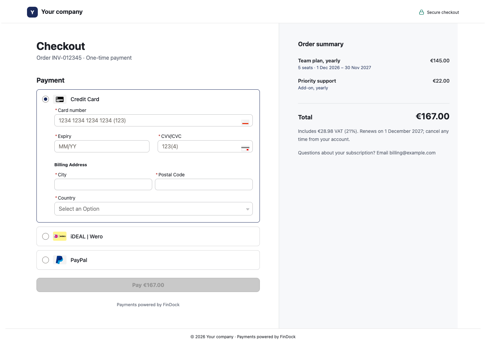
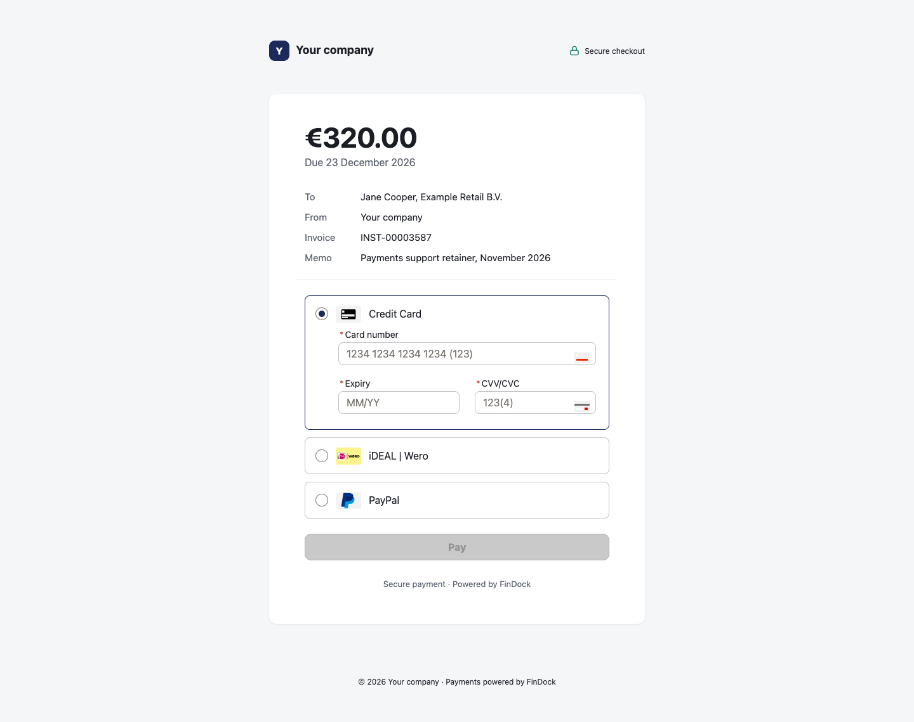
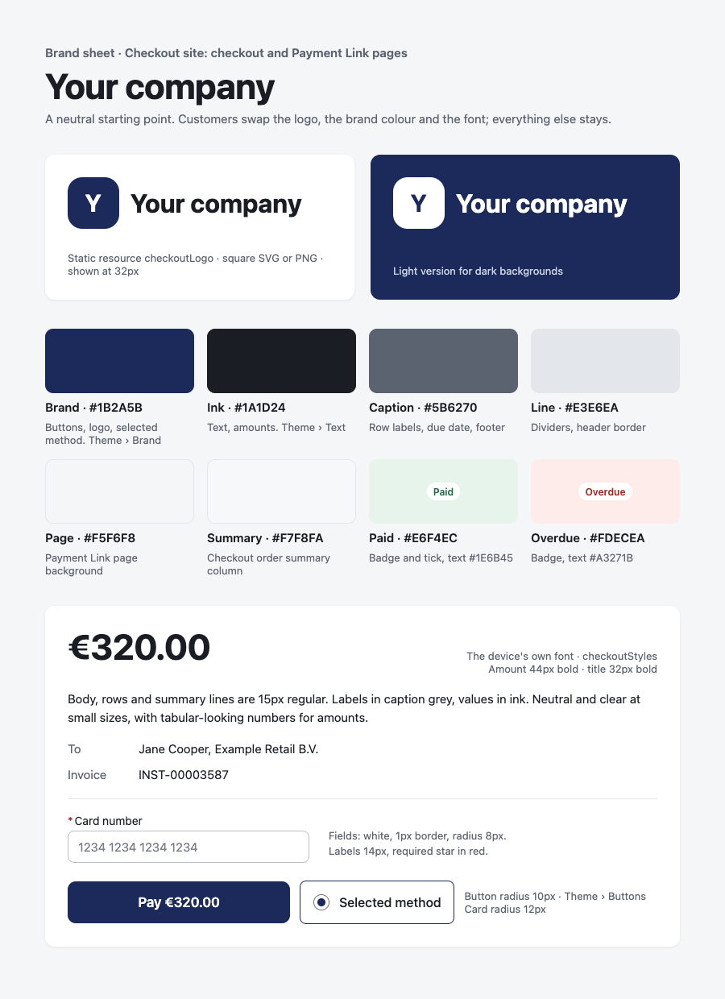

# Experience Cloud Checkout Site Template
<!-- INSTALL_LINK:START -->
<a href="https://login.salesforce.com/packaging/installPackage.apexp?p0=04tP4000001hZoLIAU" target="_blank" rel="noopener noreferrer"></a>
<a href="https://test.salesforce.com/packaging/installPackage.apexp?p0=04tP4000001sg9lIAA" target="_blank" rel="noopener noreferrer"></a>

Version 0.1.0-6 (production) · 1.0.0-3 (sandbox)
<!-- INSTALL_LINK:END -->

This Experience Cloud site template serves as a starting point for building a checkout using Experience Cloud and FinDock. It has two pages that share the header, footer, logo, theme and one style sheet:

| Page | URL | Flow |
|---|---|---|
| Checkout (Home) | `/<prefix>/` | [Checkout Flow](../checkout/): payment on the left, the order summary on the right |
| Payment Link | `/<prefix>/payment-link?id=<GUID>` | [Payment Link Flow](../payment-link/): one card for an invoice, a payment link or a recurring payment's method |
| Payment received | `/<prefix>/payment-received` | The checkout's thank-you page |

Payment Link URLs take these parameters:

```
https://<your-domain>.my.site.com/<prefix>/payment-link?id=<installment GUID>
https://<your-domain>.my.site.com/<prefix>/payment-link?id=<installment GUID>&type=link
https://<your-domain>.my.site.com/<prefix>/payment-link?id=<installment GUID>&invoice=<PDF url>
https://<your-domain>.my.site.com/<prefix>/payment-link?id=<recurring payment GUID>
```

The site is meant to be customized and extended to fit the specific use case and requirements of your site. For other options, see [the main Experience Cloud repository](../../../README.md).

*Key features*
- Collect new one-time payments
- Set up new recurring payments
- Pay existing one-time payments through a payment link (Payment Link page)
- Update the payment method of existing recurring payments (Payment Link page)


## Preview



The checkout: payment on the left, a plain-text order summary on the right (shown above the payment on a phone).



The Payment Link page: one card for an invoice, in the same brand. The page's own light-grey background sets it apart from the checkout.

### Brand



The neutral brand of the checkout and Payment Link pages. Swap the logo, the brand colour and the font for your own.

## Prerequisites
- FinDock is installed and configured.
- FinDock is the source of payments data ([FinDock Standalone](https://docs.findock.com/docs/source-connectors/findock-standalone)).
- At least one [payment extension](https://docs.findock.com/docs/payment-processors) is installed and configured.
- The [Checkout Flow](../checkout/) and the [Payment Link Flow](../payment-link/) are deployed. The site's pages reference flows named `Checkout_Flow` and `Payment_Link_Flow`; the template deploys without them, but the site cannot be *published* until they exist.
- Digital Experiences is enabled in the org.

## Installation
1. Create a new Experience Cloud site with the *Build your own (LWR)* option and name it `Checkout Page`. The name must match exactly — the site's `DigitalExperienceConfig` resolves the site by that label.
2. Press the button above to install the site template to your org.
3. Assign these to the site guest user: the `FinDockLabs Checkout Flow Guest Access` and `FinDockLabs Payment Link Flow Guest Access` permission sets and the `FinDock Payer` permission set group. Assign the two permission sets to internal users who open the site while signed in to Salesforce too, or they see an access error instead of the flow.
4. In Administration › Preferences, enable **Allow guest users to access public APIs** (the Payment Link page returns a 401 without it).
5. Customize the pages in the Experience Cloud builder.
6. Publish the Experience Cloud site.

> After a payment the Payment Link Flow sends the payer to `https://www.example.com/success` (or `/failure`). Replace these in the flow with this site's pages, e.g. `https://<your-domain>.my.site.com/<prefix>/payment-received`; see step 5 of the [Payment Link Flow installation](../payment-link/#installation).

The installation asks you to approve external.findock.com as a trusted site. This site is used to host assets for the checkout site such as icons and pictures.

> The site itself is not part of this package. `Network` and `CustomSite` are deliberately excluded in `.forceignore` because they embed the creating user's email address and the org subdomain, which are not portable between orgs. This is why the site has to be created before the template is deployed.


## Styling

The design reads the Experience Builder **Theme** panel, so you can rebrand without editing CSS:

| Theme panel setting | Drives |
|---|---|
| Brand colour | Buttons, selected states, step indicator, and the light tints derived from it |
| Background | Page background and header |
| Text colours | Body copy and captions |
| Fonts | Not used: the site uses the device's own interface font (San Francisco on Apple devices, Segoe UI on Windows, Roboto on Android), set at the top of `checkoutStyles`, so nothing is downloaded. To use a web font, put it first in that list and approve its domain as a trusted site. |
| Button and form element radius | Pills, tiles and fields |

- Layout and component overrides live in the `checkoutStyles` static resource, loaded from the site's Head Markup. Its first part styles the shared header and footer and the checkout; the Payment Link part is scoped with `body:has(.paylink)`. The Payment Link page keeps a light-grey background behind its card.
- Both pages use the checkout's page layout (header with the logo and "Secure checkout", footer). Theme layouts can't be created by a metadata deploy, so the Payment Link page doesn't get a layout of its own.
- The two background glow colours, which have no Theme panel setting, are one `:root` line in Head Markup.
- Replace the logo and images in the static resources, or point the components at your own files.
- See [Payment Experiences styling](https://docs.findock.com/docs/november-26/payments/payment-experiences-styling) for the styling hooks.
