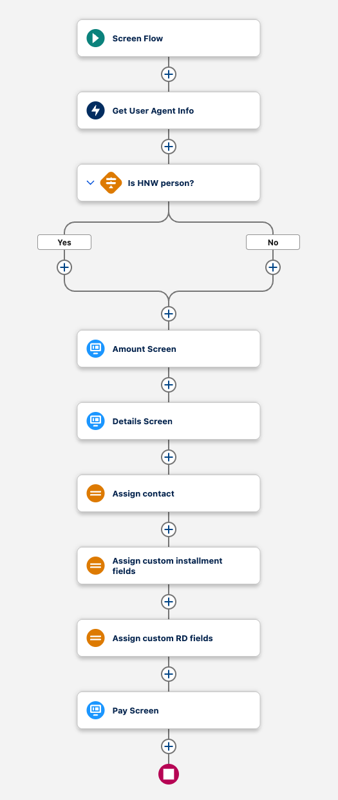

# Experience Cloud Donation Flow for NPSP
<!-- INSTALL_LINK:START -->

Version 0.1.0-4 (production) · 1.0.0-4 (sandbox)
<!-- INSTALL_LINK:END -->

> **Compatibility:** Install only one template variant per org. See the [package compatibility notes](../../../README.md#package-compatibility).

This template contains a Flow template to help you get started with building digital payment experiences using Experience Cloud and FinDock Payment Experiences. The flow is a multi-step donation process designed for NPSP.

This template is meant to be customized and extended to fit specific use cases and requirements. For other options, see [Templates for FinDock Payment Experiences](https://github.com/FinDockLabs/payment-experiences-templates).

*Key features*
- Collect one-time and recurring donations
- Configurable amounts and frequencies
- Get Gift Aid declaration from UK donors
- Optional cover transaction fees

## Preview

, styled as the fictional Canopy Gibbon Trust.](../../../docs/images/donation-site.png)

The donation flow on the [donation site](../donation-site/), styled as the fictional Canopy Gibbon Trust.

The flow in Flow Builder: the payer's browser details, an example decision, the amount and details screens, the assignments for the contact, installment and recurring donation, and the Pay screen.

## Success and failure URLs

FinDock needs a success and a failure URL for every payment. The flow uses `https://www.example.com/success` and `https://www.example.com/failure` unless the page passes the optional `successUrl` and `failureUrl` inputs (the Lightning Out embed does). Replace the example URLs in the `Success_URL` and `Failure_URL` formulas with your own pages, e.g. the donation site's `https://<your-domain>.my.site.com/<prefix>/success` and `/failure`.

## Prerequisites
- FinDock is installed and configured.
- FinDock for NPSP is installed and configured.
- At least one [payment extension](https://docs.findock.com/docs/payment-processors) is installed and configured.
- Digital Experiences is enabled in the org.

## Installation
1. Install the package using the link above.
2. Assign the **FinDockLabs Donation Flow Guest Access** permission set to your Experience Cloud site guest user. Also assign it to internal users who open the site while signed in to Salesforce: the flow only runs for users with access, so they see an access error instead of the form.
3. Complete the **FinDock Payer** permission set group assignment described in [Experience Cloud & Guest User Setup](https://github.com/FinDockLabs/payment-experiences-templates#experience-cloud--guest-user-setup).
4. Go to the donation Flow -> Payment Screen -> Payment Method Selection component and configure at least one payment method.
5. Configure the [payment intent](https://docs.findock.com/docs/payments/building-payment-experiences#using-pay-button-in-flows) (add at least success and failure URLs and verify the mapping matches your use case).
6. Activate your Flow.
7. Go to the Experience Cloud Administration -> Preferences -> enable "Allow guest users to access public APIs".
8. Add the Flow to your Experience Cloud site.

## Lightning Out

To run the flow on another website through Lightning Out 2.0, add these components to your Lightning Out app, besides the [Lightning Out flow container](../lightning-out-flow/) (`c-lightning-out-flow-container`) or your own wrapper. Lightning Out only loads components that are on the app's list: a missing one stops the flow with an unhandled fault. Publish the Lightning Out site after changing the list.

- `c-amount-and-frequency`
- `c-currency-picker`
- `c-experience-progress-stages`
- `c-get-user-agent-info`
- `cpm-pay-button`
- `cpm-payment-method-selector`
