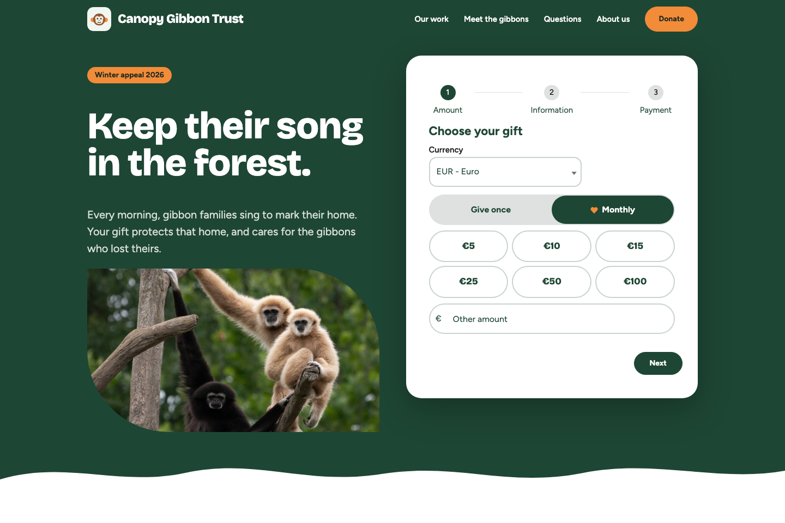
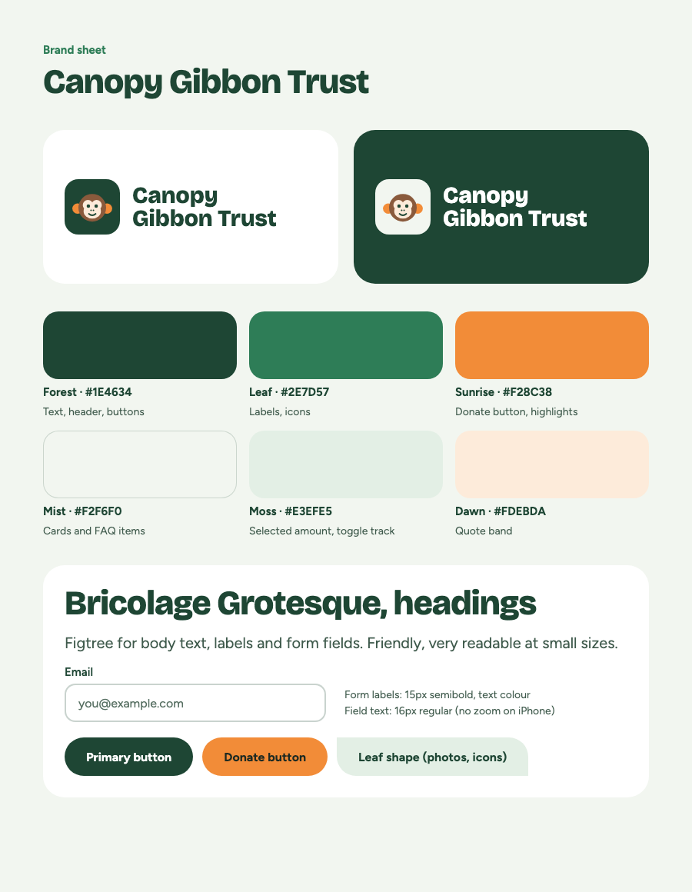

# Experience Cloud Donation Site Template
<!-- INSTALL_LINK:START -->

Version 0.1.0-3
<!-- INSTALL_LINK:END -->

This Experience Cloud site template serves as a starting point for building a donation page using Experience Cloud and FinDock. The site is a simple single page that uses one of the Donation Flows.

The site is meant to be customized and extended to fit the specific use case and requirements of your site. For other options, see [the main Experience Cloud repository](../../../README.md).

*Key features*
- Collect new one-time payments
- Set up new recurring donations

## Preview

The donation page, styled as the fictional Canopy Gibbon Trust.

### Brand

The Canopy Gibbon Trust example brand: logo, colours, fonts and components. Replace them with your own.

## Prerequisites
- FinDock is installed and configured.
- At least one payment extension is installed and configured.
- One of the [Donation Flow templates](../../../README.md#available-templates) is deployed. The site's home page references a flow named `Donation_Flow`; the template deploys without it, but the site cannot be *published* until it exists.
- Digital Experiences is enabled in the org.

## Installation
1. Create a new Experience Cloud site with the *Build your own (LWR)* option and name it `Donation Page`.
2. Press the button above to install the site template to your org.
3. Customize the page in the Experience Cloud builder.
4. Publish the Experience Cloud site.

The installation will ask you to approve three trusted sites: external.findock.com (icons and pictures), and fonts.googleapis.com and fonts.gstatic.com (the site's web fonts).

> The site itself is not part of this package. `Network` and `CustomSite` are deliberately excluded in `.forceignore` because they embed the creating user's email address and the org subdomain, which are not portable between orgs. This is why the site has to be created before the template is deployed.

## Editing the page

Every block is a standard Experience Builder component, so text, links and buttons are edited in the property panel:

| On the page | Component | CSS class |
|---|---|---|
| Logo and name, header links | Text Block (with a link) | `cgt-brand`, `cgt-nav-link` |
| Donate, Give monthly, Back to the home page | Button | `cgt-header-donate`, `cgt-quote-button`, `cgt-result-button` |
| Appeal tag, heading and intro | Text Block | `cgt-tag`, `cgt-hero-title`, `cgt-hero-text` |
| Photo | Image | `cgt-hero-photo` |
| Donation form | Flow (`Donation_Flow`) | `donate` |
| "Where your gift goes" cards | Section with three columns, each a heading and a Text Block | `cgt-cards`, `cgt-card-title`, `cgt-card-text` |
| Quote | Text Blocks and a Button | `cgt-quote`, `cgt-quote-name` |
| Questions | Rich Text (a heading per question) | `cgt-faq` |
| Footer columns | Text Blocks and Rich Text | `cgt-footer-name`, `cgt-footer-links` |

The CSS class (in each component's or section's properties) is what `canopyStyles` styles, so keep it when you replace a
component. The card icons and the logo come from the `canopyIcon*` and `canopyLogoLight` static resources.

The in-page links (`#donate`, `#work`, `#faq`, `#about`) point at four small HTML Editor blocks that only hold an anchor,
because components can't carry an id. Leave those in place, or remove a header link together with its anchor.

## Styling

The design reads the Experience Builder **Theme** panel, so you can rebrand without editing CSS:

| Theme panel setting | Drives |
|---|---|
| Brand colour | Buttons, selected states, step indicator, and the light tints derived from it |
| Background | Page background and header |
| Text colours | Body copy and captions |
| Fonts | Body and heading fonts |
| Button and form element radius | Pills, tiles and fields |

- Layout and component overrides live in the `canopyStyles` static resource, loaded from the page's Head Markup.
- The accent colour, which has no Theme panel setting, is one `:root` line in Head Markup.
- Replace the logo and images in the static resources, or point the components at your own files.
- See [Payment Experiences styling](https://docs.findock.com/docs/november-26/payments/payment-experiences-styling) for the styling hooks.
