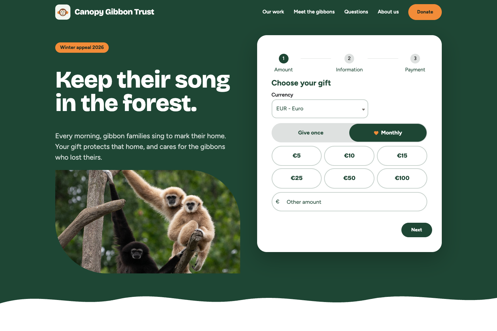
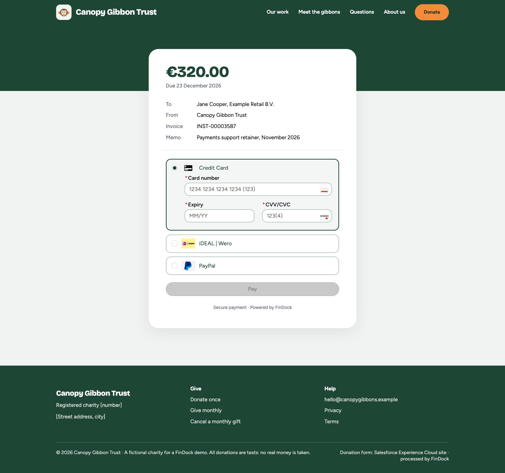
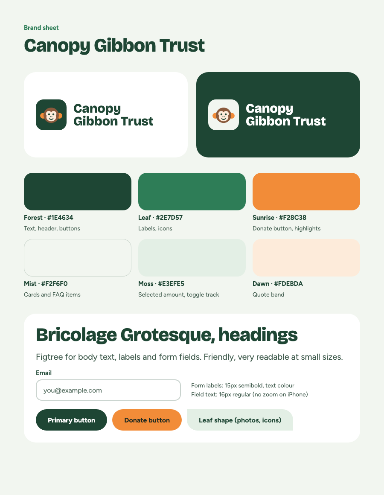

# Experience Cloud Donation Site Template
<!-- INSTALL_LINK:START -->

Version 0.1.0-3
<!-- INSTALL_LINK:END -->

This Experience Cloud site template serves as a starting point for building a donation page using Experience Cloud and FinDock. The site is a simple single page that uses one of the Donation Flows.

The site is meant to be customized and extended to fit the specific use case and requirements of your site. For other options, see [the main Experience Cloud repository](../../../README.md).

*Key features*
- Collect new one-time donations
- Set up new recurring donations
- A Payment Link page where supporters pay an invoice or change the payment method of a recurring gift, in the same brand

## Pages

| Page | URL | Flow |
|---|---|---|
| Donation page (Home) | `/<prefix>/` | One of the [Donation Flows](../../../README.md#available-templates) |
| Payment Link | `/<prefix>/payment-link?id=<installment GUID>` | [Payment Link Flow](../payment-link/): one card for an invoice, a payment link or a recurring payment's method |
| Success, Failure | `/<prefix>/success`, `/<prefix>/failure` | The donation flow's result pages |

The Payment Link page takes the same parameters as the one on the [checkout site](../checkout-site/) (`&type=link`, `&invoice=<PDF url>`) and sits in the site's header and footer.

> After a payment the Payment Link Flow sends the payer to `https://www.example.com/success` (or `/failure`). Replace these in the flow with this site's pages, e.g. `https://<your-domain>.my.site.com/<prefix>/success` and `/failure`; see step 5 of the [Payment Link Flow installation](../payment-link/#installation).

## Preview

The donation page, styled as the fictional Canopy Gibbon Trust.

The Payment Link page in the Canopy Gibbon Trust brand: the same card as on the checkout site, in the donation form's styling.

### Brand

The Canopy Gibbon Trust example brand: logo, colours, fonts and components. Replace them with your own.

## Prerequisites
- FinDock is installed and configured.
- At least one payment extension is installed and configured.
- One of the [Donation Flow templates](../../../README.md#available-templates) is deployed. The site's home page references a Flow named `Donation_Flow`; the template deploys without it, but the site cannot be *published* until it exists.
- The [Payment Link Flow](../payment-link/) is deployed, for the Payment Link page. As with the donation flow, the site deploys without it but can't be published until it exists.
- Digital Experiences is enabled in the org.

## Installation
1. Create a new Experience Cloud site with the *Build your own (LWR)* option and name it `Donation Page`.
2. Press the button above to install the site template to your org.
3. Assign these to the site guest user: the `FinDockLabs Donation Flow Guest Access` and `FinDockLabs Payment Link Flow Guest Access` permission sets and the `FinDock Payer` permission set group. Assign the two permission sets to internal users who open the site while signed in to Salesforce too, or they see an access error instead of the flow.
4. In Administration › Preferences, enable **Allow guest users to access public APIs** (the Payment Link page returns a 401 without it).
5. Customize the page in the Experience Cloud builder.
6. Publish the Experience Cloud site.

The installation asks you to approve external.findock.com as a trusted site. This site is used to host assets for the donation site such as icons and pictures.

> The site itself is not part of this package. `Network` and `CustomSite` are deliberately excluded in `.forceignore` because they embed the creating user's email address and the org subdomain, which are not portable between orgs. This is why the site has to be created before the template is deployed.

## Editing the page

Every block is a standard Experience Builder component, so text, links and buttons are edited in the property panel:

| On the page | Component | CSS class |
|---|---|---|
| Logo and name | Text Block (links to Home) | `cgt-brand` |
| Header links | Rich Text (links to `#work`, `#faq`, `#about`) | `cgt-nav` |
| Donate, Give monthly, Back to the home page | Button (links to Home, where the form is) | `cgt-header-donate`, `cgt-quote-button`, `cgt-result-button` |
| Appeal tag, heading and intro | Text Block | `cgt-tag`, `cgt-hero-title`, `cgt-hero-text` |
| Photo | Image | `cgt-hero-photo` |
| Donation form | Flow (`Donation_Flow`) | `donate` |
| "Where your gift goes" cards | Section with three columns, each a heading and a Text Block | `cgt-cards`, `cgt-card-title`, `cgt-card-text` |
| Quote | Text Blocks and a Button | `cgt-quote`, `cgt-quote-name` |
| Questions | Rich Text (a heading per question) | `cgt-faq` |
| Footer columns | Text Blocks and Rich Text | `cgt-footer-name`, `cgt-footer-links` |

The CSS class (in each component's or section's properties) is what `canopyStyles` styles, so keep it when you replace a
component. The card icons and the logo come from the `canopyIcon*` and `canopyLogoLight` static resources.

The in-page links (`#donate`, `#work`, `#faq`, `#about`) point at four small HTML Editor blocks that only hold an anchor,
because components can't carry an id. Leave those in place, or remove a header link together with its anchor.
Text Blocks and Buttons only link to a full URL or a site page, not to an anchor, which is why the header links are a
Rich Text block and the buttons link to Home.

## Styling

The design reads the Experience Builder **Theme** panel, so you can rebrand without editing CSS:

| Theme panel setting | Drives |
|---|---|
| Brand colour | Buttons, selected states, step indicator, and the light tints derived from it |
| Background | Page background and header |
| Text colours | Body copy and captions |
| Fonts | Not used: the site uses the device's own interface font (San Francisco on Apple devices, Segoe UI on Windows, Roboto on Android), set at the top of `canopyStyles`, so nothing is downloaded. To use a web font, put it first in that list and approve its domain as a trusted site. |
| Button and form element radius | Pills, tiles and fields |

- Layout and component overrides live in the `canopyStyles` static resource, loaded from the page's Head Markup.
- The Payment Link page's card comes from the last part of `canopyStyles`, scoped with the `paylink` class on the page's section. It uses the same styling as the donation form: the card on a band in the brand colour, the donation card's corners and shadow, the heading font for the amount, a pale brand tint for the selected method, pill buttons and the accent pay button.
- The accent colour, which has no Theme panel setting, is one `:root` line in Head Markup.
- Replace the logo and images in the static resources, or point the components at your own files.
- See [Payment Experiences styling](https://docs.findock.com/docs/november-26/payments/payment-experiences-styling) for the styling hooks.
