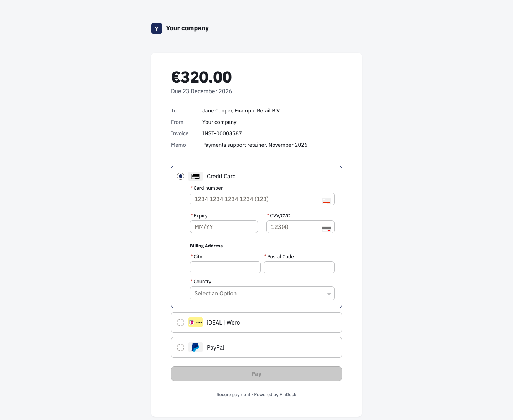
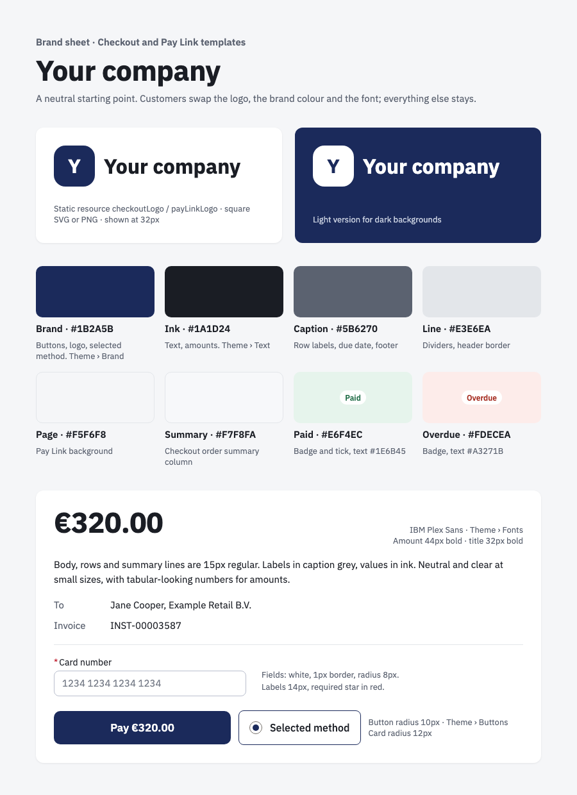

# Experience Cloud Pay Link Site Template

A neutral, single-card page for paying an invoice or a payment link, built on the [Pay Link Flow](../pay-link/). The merchant name sits above one white card: the amount and due date, a short summary, a line, then the payment methods and the Pay button.

Links look like this:

```
https://<your-domain>.my.site.com/paylink/?id=<installment GUID>
https://<your-domain>.my.site.com/paylink/?id=<installment GUID>&type=link
https://<your-domain>.my.site.com/paylink/?id=<installment GUID>&invoice=<PDF url>
```


## Preview



An invoice in the Pay Link site: the amount, a short summary and the payment methods in one card.

### Brand



The neutral brand the checkout and Pay Link templates share. Swap the logo, the brand colour and the font for your own.

## Prerequisites
- FinDock is installed and configured, with at least one payment extension.
- The [Pay Link Flow](../pay-link/) is deployed.
- Digital Experiences is enabled in the org.


## Installation
1. Create a new Experience Cloud site with the *Build your own (LWR)* option, named `Pay Link`, with URL `paylink`. The name must match exactly.
2. Deploy this package.
3. In Experience Builder, set the merchant name in the header and footer, and check the theme.
4. Assign the guest permissions listed in the flow's README to the site guest user, and allow guest access to the site.
5. Publish the site.

The installation asks you to approve three trusted sites: external.findock.com (payment method icons), and fonts.googleapis.com and fonts.gstatic.com (the web font).

> `Network` and `CustomSite` are not part of the package, for the same reason as the [checkout site](../checkout-site/): they hold org-specific values. Create the site first.


## Styling

The page reads the Experience Builder **Theme** panel:

| Theme panel setting | Drives |
|---|---|
| Brand colour | Pay button, selected payment method, merchant name |
| Background | Page background around the card |
| Text colours | Body text and the grey labels |
| Fonts | All text |

- Layout overrides live in the `payLinkStyles` static resource, loaded from the page's Head Markup.
- The flow marks row labels and badges with inline colours; the stylesheet uses those to lay out the summary rows, so keep them if you edit the flow's text.
