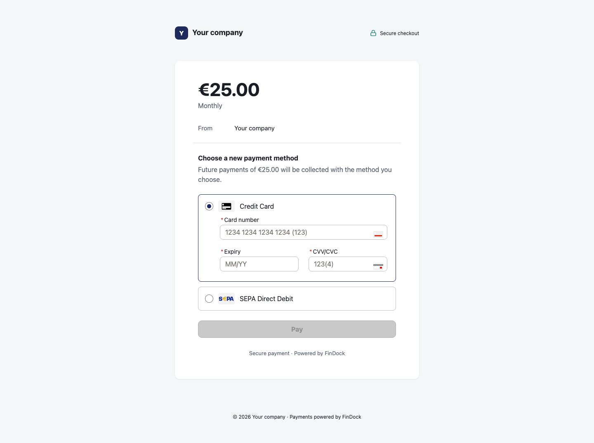
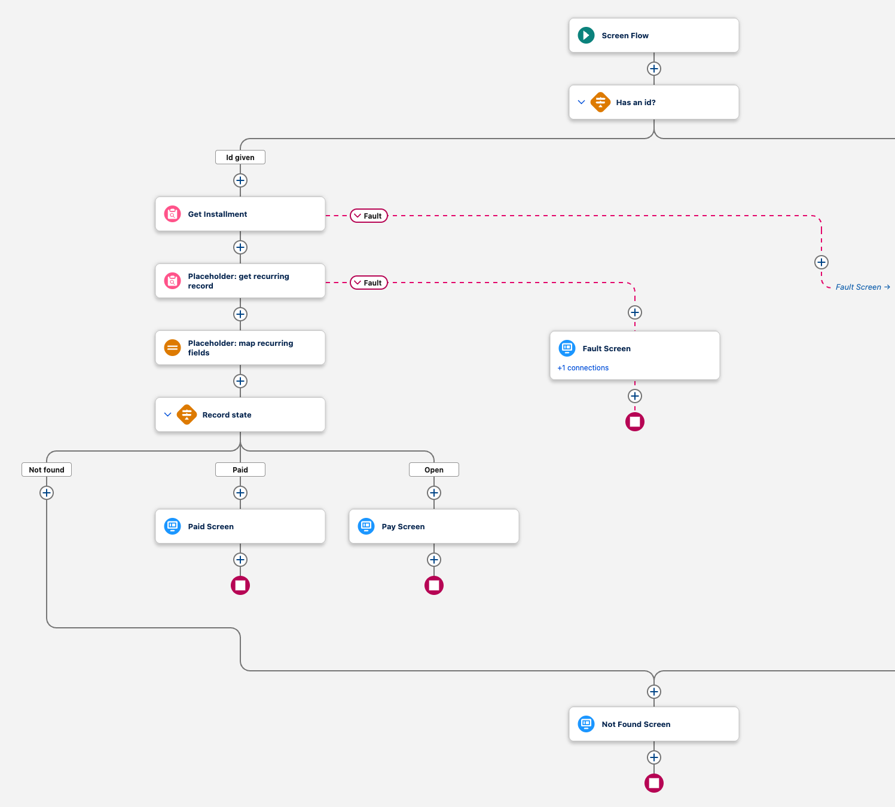

# Payment Link Flow
<!-- INSTALL_LINK:START -->

Version 1.0.0-3 (sandbox only; no released version yet)
<!-- INSTALL_LINK:END -->

A screen flow for links to an existing FinDock record: pay an invoice or a payment link, or change the payment method of a recurring payment. One card with the amount, a short summary and the FinDock payment methods. The [checkout site](../checkout-site/) and the [donation site](../donation-site/) each have a Payment Link page that runs it.

*Key features*
- Pay an existing one-time installment, found by its GUID
- Invoice mode: To, From, Invoice number and Description, with an optional invoice PDF
- Payment link mode: From and Description
- Description is the record's bank statement description; the row is hidden when it is empty
- Overdue badge when the due date has passed
- Collected installments show a paid confirmation instead of the payment methods, so an old link stays safe to open
- Recurring mode: when the id belongs to a recurring payment, the card shows its amount, frequency, From, its payment reference and description (if any), and the payer picks a new payment method for future payments (like FinDock PayLinks)
- An unknown or missing id shows a "not valid" message

The flow looks the id up as an installment and as a recurring payment, then shows one of three screens: pay, paid or not valid. The pay screen covers invoices, payment links and recurring payments with formulas instead of extra branches.

## Preview

: the amount, a short summary and the payment methods in one card.](../../../docs/images/checkout-payment-link.png)

Invoice mode on the [checkout site](../checkout-site/): the amount, a short summary and the payment methods in one card.

Recurring mode: the payer picks a new payment method for future payments.

, in its brand.](../../../docs/images/donation-payment-link.png)

The same flow on the [donation site](../donation-site/), in its brand.

The flow in Flow Builder: find the installment or the recurring record by its GUID, copy the recurring record's fields into neutral variables, then show the pay, paid or not-found screen.

## Prerequisites
- FinDock is installed and configured, with at least one payment extension.
- The installments you link to have a GUID (`cpm__GUID__c`).

## Inputs

| Variable | Purpose |
|---|---|
| `id` | GUID of the installment to pay, or of the recurring payment to update. Required. |
| `type` | `invoice` (default) or `link`. Ignored for recurring payments. |
| `invoiceUrl` | Optional link to the invoice PDF, shown as a document thumbnail in invoice mode. |
| `merchantName` | Name shown as From. Defaults to the org name. |
| `successUrl`, `failureUrl` | Optional full URLs where the payer goes after a successful or a failed payment. Embeds such as Lightning Out pass their own; without them the flow uses the example URLs below. |

For an installment, the amount is its open amount, the memo its bank statement description, and the payer its contact (and account, if set). For a recurring payment, the page shows its amount and frequency, From, and Reference when the record has a payment reference.

The pay button reads "Pay" in every mode.

## Recurring object

Two neighbouring elements are the only parts of the flow that know which object holds recurring payments:

- **Placeholder: get recurring record** finds the record by its GUID. It reads a FinDock Recurring Payment, which every FinDock org has, so the template always deploys.
- **Placeholder: map recurring fields** copies that record's fields into the `recurring*` variables. Every screen, formula and the Pay Button read those variables, never the record.

If your recurring gifts are on another object, change those two elements to match your data model:

| Variable | FinDock (default): Recurring Payment | NPSP: Recurring Donation | Nonprofit Cloud: Gift Commitment |
|---|---|---|---|
| Lookup object · GUID field | `cpm__Recurring_Payment__c` · `cpm__GUID__c` | `npe03__Recurring_Donation__c` · `npsp4hub__GUID__c` | `GiftCommitment` · `fdff__GUID__c`, then a second Get Records for its current schedule (`CurrentGiftCmtScheduleId`), which holds the amount, frequency and reference |
| `recurringId` | `Id` | `Id` | `Id` (of the Gift Commitment) |
| `recurringAmount` | `cpm__Amount__c` | `npe03__Amount__c` | schedule `TransactionAmount` |
| `recurringFrequency` | `cpm__Frequency__c` | `npe03__Installment_Period__c` | schedule `TransactionPeriod` |
| `recurringReference` (the Reference row is hidden when empty) | `cpm__Final_Payment_Reference__c` | `npsp4hub__Final_Payment_Reference__c` | schedule `fdff__Final_Payment_Reference__c` |
| `recurringDescription` (the Description row is hidden when empty) | `cpm__Bank_Statement_Description__c` | `npsp4hub__Bank_Statement_Description__c` | schedule `fdff__Bank_Statement_Description__c` |

Then select the **Pay Button** on the Pay screen and set its recurring object type to the same object, and create the guest user sharing rule (installation step 4) on that object.

**Placeholder: map recurring fields** also sets `currency`, the currency the amounts are shown in (example `EUR`). Set your org currency, or in a multi-currency org the records' `CurrencyIsoCode` (see the element's description).

## Installation
1. Deploy this package.
2. Open the flow in Flow Builder, select the **Payment Method Selector** on the Pay screen and choose the payment methods to offer (one-time and recurring). The template ships without this list because it depends on your payment extensions; without it the selector shows an error.
3. Assign the `FinDockLabs Payment Link Flow Guest Access` permission set and the `FinDock Payer` permission set group to the site guest user. Also assign the permission set to internal users who open the site while signed in to Salesforce: the flow only runs for users with access, so they see an access error instead of the card.
4. For recurring payment links: create a guest user sharing rule on your recurring object (Recurring Payment by default, see [Recurring object](#recurring-object); Setup › Sharing Settings) that shares records with the site's guest user, read only, e.g. for records where GUID is not blank. FinDock looks the recurring payment up as the guest user, and guests never see records through the organization-wide defaults; without the rule, changing the payment method fails with "Recurring record for the given Id/GUID could not be found". Installments don't need a rule.
5. Set `currency` in **Placeholder: map recurring fields** to your org currency (see [Recurring object](#recurring-object)).
6. Set the success and failure URLs. FinDock needs both for every payment, and the template ships with `https://www.example.com/success` and `https://www.example.com/failure`. In Flow Builder, open the `Success_URL` and `Failure_URL` formulas and replace the example URLs with your own pages, e.g. `https://<your-domain>.my.site.com/<prefix>/success` and `.../failure`.

## Lightning Out

To run the flow on another website through Lightning Out 2.0, add these components to your Lightning Out app, besides the [Lightning Out flow container](../lightning-out-flow/) (`c-lightning-out-flow-container`) or your own wrapper. Lightning Out only loads components that are on the app's list: a missing one stops the flow with an unhandled fault. Publish the Lightning Out site after changing the list.

- `cpm-pay-button`
- `cpm-payment-method-selector`
